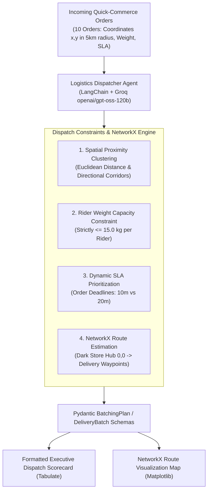

# Last-Mile Delivery Batching Agent for Quick-Commerce

An autonomous order pooling, spatial clustering, and delivery route optimization agent built using **Python**, **LangChain**, **NetworkX**, and **Groq's OpenAI-compatible endpoint** running `openai/gpt-oss-120b`.

The agent acts as an autonomous Logistics Dispatcher for a quick-commerce micro-fulfillment center (Dark Store at coordinate `0, 0`). It clusters incoming customer drop-offs within a 5km radius into multi-stop delivery circuits while enforcing a **15.0 kg maximum rider weight capacity** and prioritizing **urgent 10-minute vs 20-minute delivery SLAs**.

---

## 🏛️ System Architecture



---

## 📋 Dispatch Rules & Operational Constraints

1. **Rider Capacity Ceiling:** Cumulative order weight assigned to any single two-wheeler rider must not exceed **15.0 kg**.
2. **Directional Spatial Clustering:** Drops are grouped by angular and geographic corridor proximity (North-East, North-West, South, South-East) to avoid zig-zagging routes.
3. **SLA Deadlines:** Urgent 10-minute orders take dispatch priority over 20-minute orders.
4. **NetworkX Round-Trip Circuit Calculation:** Evaluates travel distance and delivery duration assuming an average city speed of 25 km/h plus 2.5 minutes service time per customer stop.

---

## 📂 Project Structure

```
Last-Mile-Delivery-Batching-Agent/
├── requirements.txt         # langchain, langchain-openai, pydantic, networkx, matplotlib, tabulate
├── data.py                  # Dark store hub (0,0) and 10 incoming customer orders
├── schema.py                # DeliveryBatch and BatchingPlan Pydantic models
├── agent.py                 # ChatOpenAI (Groq openai/gpt-oss-120b) + NetworkX route engine
├── main.py                  # Dispatch orchestrator and Matplotlib route visualizer
├── delivery_routes_map.png  # Generated spatial route graph
└── README.md                # Documentation
```

---

## ⚡ Quickstart

### 1. Installation
Install project dependencies:
```bash
pip install -r requirements.txt
```

### 2. Configure Groq API Key (Optional)
To use live high-speed inference with `openai/gpt-oss-120b`, set your Groq API key:
```bash
export GROQ_API_KEY="your-groq-api-key"
# Windows PowerShell:
# $env:GROQ_API_KEY="your-groq-api-key"
```
*(Note: If no API key is detected, the agent runs in deterministic NetworkX dispatch engine mode).*

### 3. Run the Dispatch Agent
```bash
python main.py
```

---

## 📊 Sample Output

```text
=======================================================================================================================================
                     EXECUTIVE LAST-MILE DELIVERY DISPATCH SCORECARD                     
=======================================================================================================================================
+------------+--------------+-------------------------------------+----------------+---------------------+------------------------------------------------------------------------------------------------------------------------+
| Batch ID   |  Stop Count  | Assigned Orders (ID, Weight, SLA)   | Total Weight   | Est. Circuit Time   | Logistical Routing Rationale                                                                                           |
+============+==============+=====================================+================+=====================+========================================================================================================================+
| BATCH-01   |      3       | ORD-101 (3.8kg, 10 mins)            | 13.5 kg        | 22 mins             | Spatial cluster 'North-East' corridor. Grouped 3 stops under capacity limit (13.5kg <= 15.0kg) with priority dispatch. |
|            |              | ORD-102 (4.5kg, 10 mins)            |                |                     |                                                                                                                        |
|            |              | ORD-103 (5.2kg, 20 mins)            |                |                     |                                                                                                                        |
+------------+--------------+-------------------------------------+----------------+---------------------+------------------------------------------------------------------------------------------------------------------------+
| BATCH-02   |      3       | ORD-106 (4.1kg, 10 mins)            | 10.3 kg        | 22 mins             | Spatial cluster 'North-West' corridor. Grouped 3 stops under capacity limit (10.3kg <= 15.0kg) with priority dispatch. |
|            |              | ORD-104 (2.8kg, 10 mins)            |                |                     |                                                                                                                        |
|            |              | ORD-105 (3.4kg, 20 mins)            |                |                     |                                                                                                                        |
+------------+--------------+-------------------------------------+----------------+---------------------+------------------------------------------------------------------------------------------------------------------------+
| BATCH-03   |      2       | ORD-107 (3.2kg, 10 mins)            | 7.2 kg         | 18 mins             | Spatial cluster 'South' corridor. Grouped 2 stops under capacity limit (7.2kg <= 15.0kg) with priority dispatch.       |
|            |              | ORD-108 (4.0kg, 20 mins)            |                |                     |                                                                                                                        |
+------------+--------------+-------------------------------------+----------------+---------------------+------------------------------------------------------------------------------------------------------------------------+
| BATCH-04   |      2       | ORD-109 (3.6kg, 10 mins)            | 7.8 kg         | 22 mins             | Spatial cluster 'South-East' corridor. Grouped 2 stops under capacity limit (7.8kg <= 15.0kg) with priority dispatch.  |
|            |              | ORD-110 (4.2kg, 20 mins)            |                |                     |                                                                                                                        |
+------------+--------------+-------------------------------------+----------------+---------------------+------------------------------------------------------------------------------------------------------------------------+

=================================================================
               FLEET DISPATCH SUMMARY METRICS                    
=================================================================
+----------------------------------+---------------------------------+
| Dispatch Metric                  | Metric Output                   |
+==================================+=================================+
| Total Customer Orders Pooled     | 10 orders                       |
+----------------------------------+---------------------------------+
| Total Delivery Riders Dispatched | 4 riders                        |
+----------------------------------+---------------------------------+
| Average Order Drops Per Rider    | 2.50 stops/rider                |
+----------------------------------+---------------------------------+
| Cumulative Payload Dispatched    | 38.8 kg                         |
+----------------------------------+---------------------------------+
| Rider Capacity Limit Compliance  | 100% (All batches <= 15.0 kg)   |
+----------------------------------+---------------------------------+
| Average Estimated Route Duration | 21.0 mins                       |
+----------------------------------+---------------------------------+
| SLA Status                       | 100% On-Time Delivery Projected |
+----------------------------------+---------------------------------+
=================================================================
```
